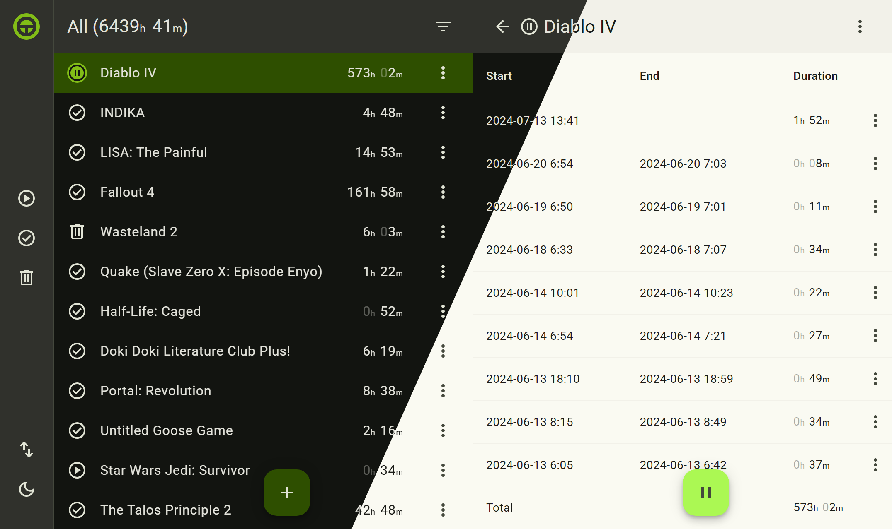

# Timer

[Timer](https://klaster1.github.io/timer-5) is a simple time tracking tool. Create a task, click "Start"/"Stop", see how much the task took, repeat.

All the data is kept in the `localStorage`, it does not leave your device, ever. To manage the data, use "Export" (to JSON) and "Import" features. A test data set can be found [here](https://gist.githubusercontent.com/Klaster1/a456beaf5384924fa960790160286d8a/raw/179c67dad43c66d48fb7c766f1e19b58df4c64cf/games.json).

Originally created back in 2011 to track my time spent on video games, it eventually turned into sorts of Todo MVC, the project gets rewritten from scracth every several years as a learning excercise. This is the fifth iteration. Some of previous Timer iterations:

- https://github.com/Klaster1/timer
- https://github.com/Klaster1/timer2

# Development

You will need Node.js 22 or newer.

## Running the app for development locally

1. Install packages with `npm i`.
2. Run `npx ng serve`. The app will start at [http://localhost:4200](http://localhost:4200).
3. Change the Angular app, the web page will live reload.

## Building the app

1. Install packages with `npm i` if you haven't already.
2. Run `npm run build`. Static files will be placed in the `dist` directory.

# WebMCP

The app registers tools with WebMCP, so an AI agent in the browser can read and change the tasks:

- `list_tasks`: lists tasks, filtered by state and name.
- `get_task`: returns one task with its sessions.
- `get_time_report`: sums the time per task in a date range.
- `create_task`: creates a task, optionally started.
- `start_task`, `stop_task`: start or end a session.
- `rename_task`, `set_task_state`: rename a task or move it to the active, finished or dropped list.
- `edit_session`, `delete_session`: change or remove one session.
- `delete_task`: removes a task. The agent asks you first.

WebMCP is an experimental Chrome feature. The deployed site carries an origin-trial token. On `localhost`, turn on `chrome://flags/#enable-webmcp-testing` and restart Chrome.
